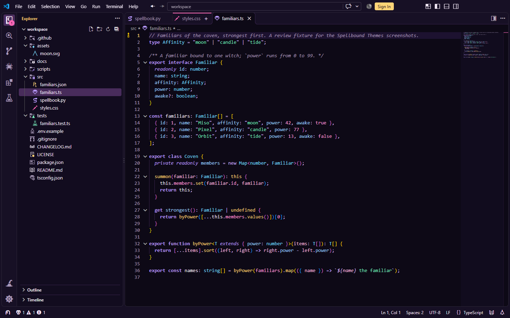
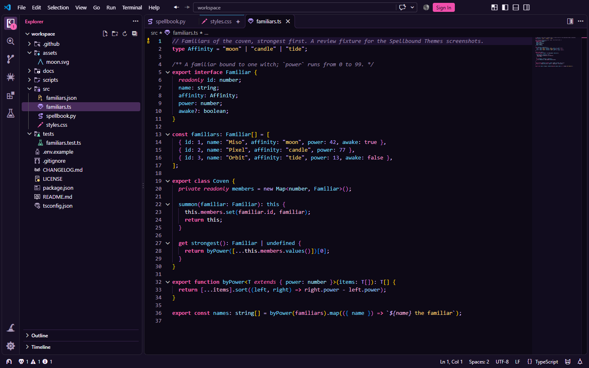
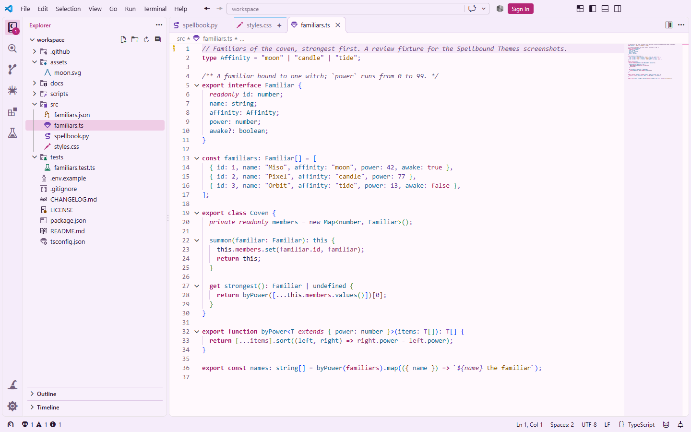
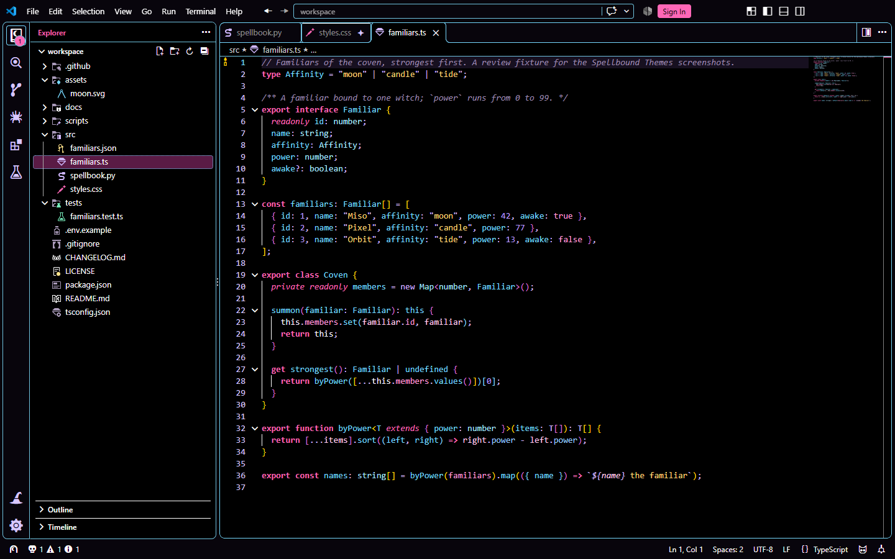
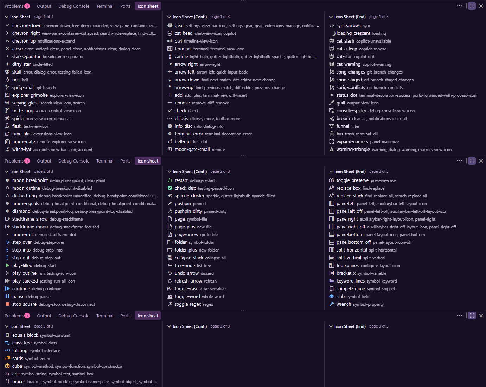
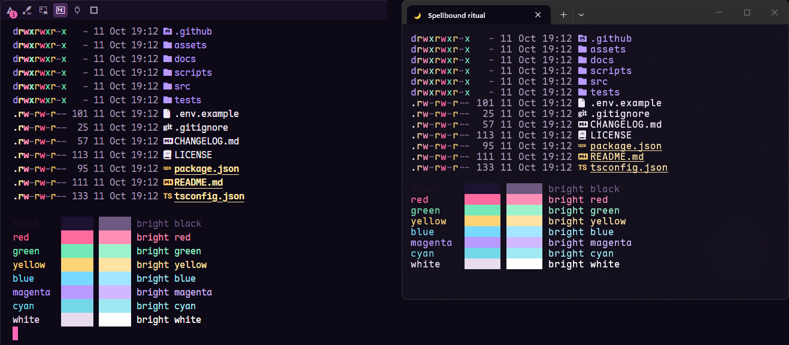

# WitchyNibbles Spellbound Themes

Four VS Code color themes, a file icon theme and a product icon theme that share one witchy palette. The flagship, **Moonlit Candle**, takes its palette from the [Moonlit Candle](https://github.com/WitchyNibbles/moonlit-candle) terminal theme (witchyterm), the same theme for Claude Code, Windows Terminal and fish: candle gold for what is active, pink for what needs you, lavender for keywords and focus, on a deep moonlit night.



## The color themes

- **WitchyNibbles Moonlit Candle** (dark): gold `#FFD477` for the active tab, buttons and functions, pink `#FF67B7` for badges and the cursor, lavender `#B99AFF` for keywords and focus, violet `#633B79` for selection, mint for added, amber for modified, rose for errors. Its integrated terminal is witchyterm's Moonlit Candle scheme, colour for colour.
- **WitchyNibbles Moonlit** (dark): the same night with neon pink accents, mint for added and amber for warnings, and the same terminal colours.
- **WitchyNibbles Daydream** (light): pale lilac surfaces with deep purple text.
- **WitchyNibbles Coven Contrast** (high contrast): black surfaces, white borders, cyan focus rings, pink for the active tab and the selection.

In all four, only keywords are bold, and not the ones the grammars mark as operators (such as `new`, `typeof`, `and` and `in`); comments, documentation and storage modifiers are italic.







## The icons

**WitchyNibbles Icons**, the file icon theme, draws each file type as a small object, coloured by what it holds: code lavender, data gold, style pink, tests mint, config muted, docs ivory, images and fonts cyan. JavaScript is a rough crystal cluster, TypeScript a cut gem, Python a coiled snake, JSON a keyring, Markdown a quill and any other file a plain parchment. Folders carry a badge for their contents: a grimoire on `src`, a flask on `tests`, a spider on its thread on `node_modules`. A dark, a light and a high-contrast set follow the color theme. The high-contrast set is drawn for dark high-contrast themes such as Coven Contrast. VS Code also uses it with a light high-contrast theme (its own Light High Contrast, for example), where the file icons have low contrast and the white docs icons (README, LICENSE, Markdown and text files) all but disappear.

**WitchyNibbles Product Icons**, the product icon theme, redraws the icons of the workbench: the 132 icons VS Code 1.141 shows in a normal session, from the activity bar to the debug toolbar, and 45 related ones. Icons outside that set keep VS Code's own.



The file and product icons are original drawings made for this extension. A file icon may echo a language's name, never its logo, and the icons are not affiliated with or endorsed by any language, framework or tool.

| Icon | Means |
| :- | :- |
| ✦ | needs attention or changed: an unsaved tab, notifications, a dirty branch |
| ✧ cluster | AI actions |
| candle | an idea or a code action (the light bulb) |
| full moon | here, a stop point: breakpoints and the current step |
| sprig | a branch, source control |
| cat | helpers and familiars: chat and Copilot |
| owl | time: the timeline, the changelog |
| skull | failure or error; danger or a secret |
| flask | testing |
| broom | clearing |
| ⋆ | a separator |

## Settings

Pick the themes with **Preferences: Color Theme**, **Preferences: File Icon Theme** and **Preferences: Product Icon Theme**, or add them to your `settings.json` with the settings a theme cannot set for you:

```jsonc
{
  "workbench.colorTheme": "WitchyNibbles Moonlit Candle",
  "workbench.iconTheme": "witchynibbles-icons",
  "workbench.productIconTheme": "witchynibbles-product-icons",
  // Unsaved tabs get Moonlit Candle's pink border (VS Code's default is false).
  "workbench.editor.highlightModifiedTabs": true,
  // witchyterm's font, with its italics. Install Maple Mono NF first.
  "editor.fontFamily": "'Maple Mono NF', Consolas, monospace",
  "terminal.integrated.fontFamily": "'Maple Mono NF'"
}
```

[Maple Mono NF](https://github.com/subframe7536/maple-font) is the font witchyterm uses; a color theme cannot choose a font, so it is a recommendation.

The ✦ on an unsaved tab takes the tab's text colour, because no theme colour reaches it; with `workbench.editor.highlightModifiedTabs` on, Moonlit Candle also gives the tab a pink top border.

## The terminal

Moonlit Candle and Moonlit give the integrated terminal witchyterm's Windows Terminal scheme: the background, foreground, cursor, selection and all 16 ANSI colours. VS Code lightens text it finds too dim (`terminal.integrated.minimumContrastRatio`, 4.5 by default), and witchyterm's black `#1D1230` and bright black `#6E5A80` are dim on purpose. For colours that match Windows Terminal exactly, add:

```json
"terminal.integrated.minimumContrastRatio": 1
```

The extension does not set it for you: at 1, dim text keeps witchyterm's low contrast.



Left, VS Code's integrated terminal in Moonlit Candle with `terminal.integrated.minimumContrastRatio` at 1; right, Windows Terminal with witchyterm's Moonlit Candle profile. Both run witchyterm's `ll` in the same folder, then print the 16 colours.

Known difference: Windows Terminal draws witchyterm's moon background image and its translucency; VS Code's terminal has no background image, so it is plain `#0D0916`.

## Install

- **Visual Studio Marketplace:** search for WitchyNibbles Spellbound Themes in the Extensions view, open the [Marketplace page](https://marketplace.visualstudio.com/items?itemName=EimiMartinez.witchynibbles-theme-collection), or run `code --install-extension EimiMartinez.witchynibbles-theme-collection`.
- **GitHub Releases:** download `witchynibbles-theme-collection-2.0.0.vsix` from [Releases](https://github.com/WitchyNibbles/Spellbound-Themes/releases), then run **Extensions: Install from VSIX...** in VS Code, or `code --install-extension witchynibbles-theme-collection-2.0.0.vsix`.
- **Back to 1.2.1:** in the Extensions view, open the gear menu of WitchyNibbles Spellbound Themes, choose **Install Another Version...** and pick 1.2.1. The [CHANGELOG](CHANGELOG.md) lists what changed.

Requires VS Code 1.100 or later; the icons are drawn for VS Code 1.141.

## Build locally

```sh
npm ci
npm run validate
npm run package
```

`npm run package` builds the themes and icons, runs every validation check (`validate --release`), and packages `witchynibbles-theme-collection-2.0.0.vsix` with fixed timestamps. It does not publish. The same source gives the same bytes from a checkout with LF line endings (git's default on Linux and macOS). On Windows, `core.autocrlf` checks `package.json`, README, CHANGELOG and LICENSE out with CRLF line endings; the build does not regenerate them, so the VSIX built there has a different SHA-256 from the one in the release notes.

The build needs Node.js 22 or later (2.0.0 was built with Node.js 24) and npm. `npm test` also needs git, python3 with Pillow and tesseract (the image, release and privacy-scan tests), and checks the packaged VSIX when there is one in the repository root. Some tests depend on the machine:

- One test compares the terminal colours with Moonlit Candle's. It runs only when that repository is cloned beside this one as `witchyterm` (`git clone https://github.com/WitchyNibbles/moonlit-candle ../witchyterm`); otherwise it is skipped.
- Two tests audit the icon IDs of VS Code 1.141's own workbench bundle. They find a per-user Windows install of that build from WSL, or the bundle's path in `VSCODE_WORKBENCH_JS`; otherwise they are skipped.
- Under WSL, the privacy-scan tests read the Windows user name through `cmd.exe`, so the Windows system folders must be on `PATH`: `export PATH="$PATH:/mnt/c/Windows/System32:/mnt/c/Windows"`. Without them, those tests fail.

The screenshots are real captures from VS Code and Windows Terminal; [docs/qa/2.0.0-release](docs/qa/2.0.0-release/README.md) records how each one was made.

## License

MIT. [LICENSE.md](LICENSE.md).
